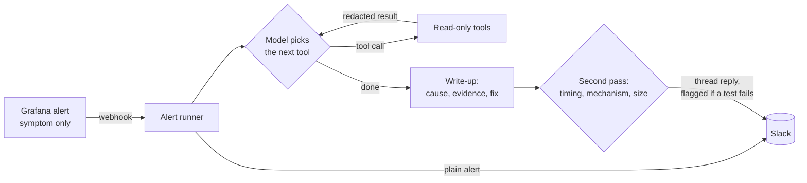
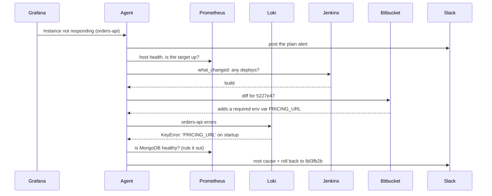
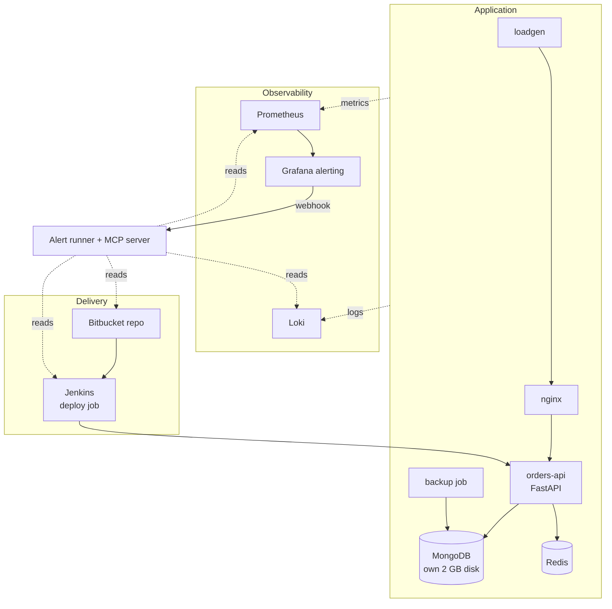

# devops-mcp

An agent that picks up a generic monitoring alert and works out why it fired.

Most alerting tells you a symptom: "disk almost full", "instance not responding". Someone on call then spends twenty minutes in Grafana, Loki, Jenkins and the git host figuring out the cause. This project does that digging automatically and posts the answer under the alert in Slack, with evidence and a proposed fix. It is read-only: it proposes, a person decides.

I built it against a small replica of a real EC2 stack, with failures I plant on purpose so I can score whether the agent gets them right.

## What it looks like

Grafana fires this, and nothing more:

> :red_circle: **[FIRING] Disk almost full**
> Disk /mnt/mongo-data on lab-host-1 is over 85% full

About twenty seconds later the agent replies in the thread. This is a real write-up from the lab, with the evidence lines shortened:

> **Affected:** `mongodb` on `lab-host-1` (`/mnt/mongo-data`)
>
> **Started:** `2026-11-12 19:17:54 UTC`; disk usage jumped from `22.6%` to `100%` in about `4m 50s` on a `2.04 GB` MongoDB data disk
>
> **Root cause:** `orders-api` enabled debug capture at `19:17:54 UTC`, which writes full request payloads into MongoDB collection `shop.audit_events`. That collection exploded from ~`9 MB` to ~`930 MB` within ~`2m 15s`, filled the MongoDB volume, and MongoDB then hit WiredTiger `No space left on device` fatal assertions.
>
> **Evidence:**
> - `19:17:54Z` orders-api log: `"event": "debug_capture_changed", "enabled": true`
> - `/mnt/mongo-data` usage was `22.57%` at `19:15:45Z` and `100.0%` at `19:21:45Z`
> - `shop.audit_events` grew from `9,000,456` bytes to `930,047,120` bytes; `shop.orders` stayed flat
> - `19:20:44Z` MongoDB log: `"No space left on device"`, followed by `"Fatal assertion"`
>
> **Proposed fix:** Immediately disable debug capture, then delete/expire `shop.audit_events` data and restart MongoDB if needed. After recovery, add a TTL/capped policy or move debug payloads off the primary DB.
>
> **Confidence:** high. I could not verify who or what triggered the debug toggle.
>
> _14 tool calls · 18s · 25,682 tokens · $0.06 · gpt-5.4_

Nothing in the agent's instructions mentions debug capture or that collection. It found them by querying.

## How it works



The runner is a small FastAPI service. When Grafana calls it, the model gets the alert and a set of tools, and decides for itself what to look at, up to a fixed number of steps. Every tool result passes through one function that masks phone numbers and emails and appends a line to an audit log before the model sees anything.

Before the write-up is posted, a second model call gets the same tool results and the draft, and tests the named cause three ways: did it change shortly before the problem began, does a log line or diff show how it causes this symptom, and does it account for the size of the change. If a test fails, the write-up still posts, with a "double-check this one" line and the reason under it. The second pass never rewrites the answer. I tried that first, and it broke as many correct answers as it fixed (see Evals).

A typical investigation of a bad deploy:



## The tools

| Tool | What it answers | Source |
|---|---|---|
| `service_map` | Which service owns this host or disk, and what depends on what | config |
| `host_health` | Is the host up, how full are its disks, memory, CPU | Prometheus |
| `query_metrics` | Any PromQL query, now or as a trend over a window | Prometheus |
| `list_metrics` | What metrics exist with this word in the name | Prometheus |
| `disk_usage_breakdown` | How much a disk grew, how much each known consumer accounts for, and how much is unexplained | Prometheus |
| `log_summary` | Log lines counted by kind, rarest first | Loki |
| `get_logs` | Raw log lines with filters | Loki |
| `list_deploys` | Deploy history for a service | Jenkins |
| `get_diff` | What a commit changed | Bitbucket |
| `what_changed` | Deploys, restarts and new kinds of log line for a service, in one call | all of the above |
| `post_update` | Post to the alerts channel | Slack |

Three of these exist because the agent failed without them. In early runs it missed a single config-change log line buried under thousands of routine request lines, so `log_summary` now surfaces rare lines first. It also guessed a metric label wrong and read the empty result as "no data", so empty results now come back with the label names that do exist. And in the first eval pass it kept blaming a backup job for disk growth the job could not have produced, so `disk_usage_breakdown` now puts the numbers side by side: how much the disk grew, how much each database and collection grew, and how much is left unexplained.

The same tools are exposed as an MCP server (`agent/mcp_server.py`), so an engineer can ask the same questions from Claude Code.

## Guardrails

- The agent's logins are read-only. Its Jenkins user gets a 403 if it tries to start a build.
- Tools are an allowlist in code. The model cannot call anything else.
- Phone numbers and emails are masked before any log line reaches the model.
- Every tool call is written to an audit log with time, tool, arguments and result size.
- The model cannot post to Slack on its own. The runner posts its final write-up and nothing else.
- A second pass checks the cause against the evidence and flags the write-up when it does not hold up.

## Follow-up questions in Slack

Reply in an alert thread and mention the bot, for example `@alert-agent what else was deployed to orders-api today?`. It loads the investigation for that thread, uses the same read-only tools, and answers in the thread. It only answers when mentioned, and only under its own write-ups.

This runs over Slack's Socket Mode (`agent/followup.py`): the machine opens the connection to Slack, so nothing has to be reachable from the internet. It is off unless `SLACK_APP_TOKEN` is set.

## The lab

Everything runs in Docker Compose on one small VM, listening on localhost only.



MongoDB sits on its own 2 GB loopback filesystem, so a "disk full" failure stays contained and resets in seconds. Grafana has two alert rules, both generic on purpose: disk over 85%, and scrape target down.

## Evals

Each test is a failure I plant where I already know the answer. The harness resets the lab (including wiping metrics and logs, so one run cannot leak into the next), plants the failure, waits for the write-up, and grades it against an answer key the agent never sees.

| Scenario | Alert the agent sees | What is really going on |
|---|---|---|
| Debug switch | Disk almost full | A config switch makes the app write 1.5 MB per request |
| Backup loop | Disk almost full | The backup job fails verification and retries, leaving partial dumps |
| Deploy, slow burn | Disk almost full | A deploy passes its health check, then fills a new collection |
| No trace (trap) | Disk almost full | A file dropped on the disk by hand. The right answer is "can't determine" |
| Deploy crash | Instance not responding | A commit requires an env var that isn't set |
| Stopped by hand | Instance not responding | Clean shutdown, no deploy, no crash |
| Decoy deploy (trap) | Disk almost full | A harmless deploy lands a minute before the debug switch flips |

Four different causes sit behind the same alert, which is the point: the agent can't match the alert to a memorised answer.

Each run is graded on five things:

| Check | Graded by |
|---|---|
| Right service named | code |
| Start time within two minutes of when the failure was planted | code |
| Root cause matches the answer key | a second model, strict rubric |
| Proposed fix would resolve the real problem | a second model |
| Quoted evidence appears in what the tools returned | code, against the run transcript |

The suite runs three configurations: `gpt-5.4`, `gpt-5.4-mini`, and `gpt-5.4` with the three workflow tools (`what_changed`, `log_summary`, `disk_usage_breakdown`) removed, to measure what those tools are worth.

### Results

63 runs: seven scenarios, three runs each, three configurations. "Root cause" is the strict grade.

| | `gpt-5.4` | `gpt-5.4-mini` | `gpt-5.4`, no workflow tools |
|---|---|---|---|
| Root cause right | 13 of 21 | 8 of 21 | 11 of 21 |
| Proposed fix acceptable | 19 | 10 | 13 |
| Start time within two minutes | 21 | 21 | 21 |
| Right service | 19 | 21 | 17 |
| Average cost | $0.079 | $0.028 | $0.132 |
| Average time | 16.5 s | 7.9 s | 16.5 s |

Root cause by scenario, out of three:

| Scenario | `gpt-5.4` | mini | no workflow tools |
|---|---|---|---|
| Debug switch | 3 | 3 | 0 |
| Backup loop | 3 | 0 | 2 |
| Deploy, slow burn | 3 | 3 | 3 |
| Deploy crash | 2 | 2 | 3 |
| Stopped by hand | 1 | 0 | 2 |
| No trace (trap) | 1 | 0 | 0 |
| Decoy deploy (trap) | 0 | 0 | 1 |

How I read the `gpt-5.4` column:

- Three of the eight misses are plainly wrong. Twice on the no-trace trap it blamed the backup job, whose logs showed a few 100 MB dumps against a 1.4 GB jump. Once on the deploy crash it found the missing env var and never named the commit.
- The other five named the right cause and fix and failed a strict rule. All three decoy runs found the debug switch and ignored the decoy deploy, but also said the backup job contributed part of the fill, which the answer key forbids. Two stopped-by-hand runs said "clean shutdown, trigger unknown" and lost on wording. I left the answer keys and the judge alone.
- The workflow tools pay for themselves: more causes right, far more usable fixes, and 40% cheaper, because the agent needs fewer calls.
- `gpt-5.4-mini` is a third of the cost and not good enough. It proposes an acceptable fix less than half the time.

### What the first pass taught me

The first pass (one run per cell) scored 5 of 7 on root cause for `gpt-5.4` and got the start time right in 9 of 21 runs overall. Reading the transcripts turned up one problem in my lab and several in the agent:

- My reset only stopped containers, so the log shipper replayed the previous run's errors into the next run. 11 of 15 disk runs were contaminated. The reset now removes the containers, and every run records how many pre-reset log lines it can see (it has been zero since).
- `query_metrics` returned one or two points for a wide window, so the agent never saw the curve. It now returns up to 240 steps and reports when a series left its starting level.
- `what_changed` on a database did not show the services that write to it.
- The prompt let the agent name a suspect without checking that it accounts for the size of the problem.

After those fixes, start time went to 63 of 63.

### The second pass

The agent's remaining weakness is saying "I can't tell". My first idea was a reviewer that rewrites the write-up when the cause fails a test. Before shipping it I replayed it over the 21 saved `gpt-5.4` runs (`evals/replay_review.py`: same evidence, with and without the reviewer, no lab needed). It fixed five wrong answers and broke five right ones.

So the second pass only flags. On the same 21 runs the flag fires on 4 of the 8 wrong answers and 1 of the 13 right ones. It catches both no-trace runs that blamed the backup job.

## Cost

Measured on the lab, `gpt-5.4`, 21 runs:

| | |
|---|---|
| Per investigation | $0.08 on average ($0.06 to $0.11) |
| Alert to write-up | 17 seconds on average |
| Tool calls | 10 on average |
| With the second pass | about $0.04 and 8 seconds more |

At 20 alerts a day that is about $2.50 a day with the second pass on. Every run logs its tokens and cost, and the model is one line in `agent/config.yaml`.

## Run it

You need a Linux VM with Docker, a Slack bot token, an OpenAI key, and a Bitbucket repo for the demo app.

```bash
cp .env.example .env                 # fill in the tokens
bash lab/scripts/setup-mongo-disk.sh # 2 GB loopback disk for MongoDB
cd lab && docker compose up -d       # the whole stack

cd ../agent
python3 -m venv .venv && .venv/bin/pip install -r requirements.txt
.venv/bin/uvicorn runner:app --host 0.0.0.0 --port 8088
```

Then break something:

```bash
bash lab/scripts/break-disk-full.sh    # debug switch on; alert in about 5 minutes
bash lab/scripts/reset.sh              # back to healthy

bash lab/scripts/break-bad-deploy.sh   # deploy the crashing commit
bash lab/scripts/rollback-deploy.sh
```

Run the evals on the VM:

```bash
cd evals && ~/agent/.venv/bin/python run_evals.py --repeats 3

# replay the second pass over saved runs, without touching the lab
~/agent/.venv/bin/python replay_review.py --infile results.jsonl --mode fresh --out review.jsonl
```

For follow-up questions in Slack, turn on Socket Mode for the Slack app, subscribe it to `app_mention`, and put the app-level token in `.env` as `SLACK_APP_TOKEN`.

## Layout

```
agent/    tools.py (the tools, redaction, audit log), runner.py (alert runner and second pass),
          followup.py (Slack follow-ups), mcp_server.py, config.yaml (model, prices, service map)
lab/      docker-compose.yml, the demo app, Grafana rules, Jenkins config, break/reset scripts
evals/    scenarios.yaml (failures and answer keys), run_evals.py (harness and grader),
          replay_review.py (replays the second pass over saved runs)
```

## What it can't do yet

- It only finds causes that leave a trace in metrics, logs or deploy history. Someone editing a file by hand on a box is invisible to it. The "no trace" scenario checks that it says so, and it does only one time in three. The other two times it blames the nearest plausible suspect. The double-check flag catches those; the agent itself does not.
- It likes to explain every last megabyte. When a cause accounts for most of a change, it tends to pin the remainder on a routine background job without evidence.
- The lab is one host and a handful of services. Real systems are noisier.
- Redaction misses phone numbers written as a bare run of digits, because they look like timestamps.
- Jenkins runs as root with the Docker socket in the lab. Fine for a lab, wrong for production.
- Seven scenarios and three runs each is a small test. The numbers above are indications, not rates.
- The MCP server exposes the same tools but I have not tested it from a client yet.
- Nothing writes yet. The next step is a Slack button under the proposed fix that runs one allowlisted Jenkins job, such as a rollback.
